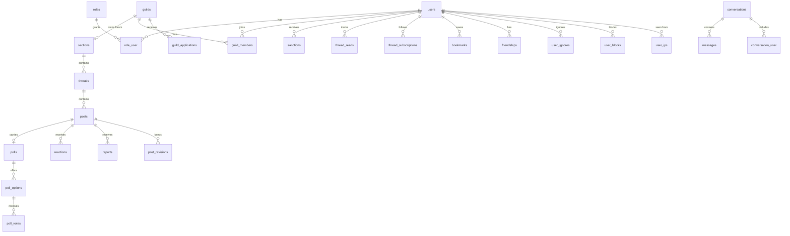

# Architecture

## Stack

| Layer | Choice |
|---|---|
| Framework | Laravel 11 on PHP 8.3 |
| Interactivity | Livewire 3 (ships Alpine.js), `wire:navigate` for page changes without reloads |
| Database | PostgreSQL 16 (full-text search with generated `tsvector` columns) |
| Styles | One hand-written stylesheet, `public/css/forum.css`; no build step |
| Scripts | Inline Alpine setup in the layout and `public/js/forum-nav.js` |
| Sanitizing | `mews/purifier` (HTMLPurifier) behind a CommonMark renderer |
| Translations | JSON files in `lang/` plus `laravel-lang` for framework strings |
| Tests | Pest 3 with `pest-plugin-laravel`, against a dedicated PostgreSQL database |

There is no Node build, no queue worker and no websocket server. Live updates use Livewire polling (20 s).

## Folders

```
app/
  Http/Controllers/     Page controllers: forum, profile, feeds, community, auth, email verification
  Http/Middleware/      EnsureRole, TouchLastSeen (last seen + IP), SetLocale, BlockBannedIp
  Livewire/             Every interactive component (see features.md)
  Livewire/Admin/       Users, Sections, Roles, Security
  Livewire/Concerns/    BuildsPoll trait shared by the thread and reply composers
  Models/               Eloquent models
  Notifications/        ForumActivity, the single database notification
  Policies/             Authorization (auto-discovered by name)
  Providers/            AppServiceProvider: gates, rate limiters, morph map, auth event listeners
  Services/             Business logic; components and controllers stay thin
  Support/Community.php Community and locale resolution
config/forum.php        Communities, guild limit, security retention
config/purifier.php     "forum" HTML whitelist
database/migrations/    Schema history
database/seeders/       Roles, sections, demo data
lang/                   Translations (JSON + framework PHP files)
public/css, public/js   Front-end assets
resources/views/        Blade: layout, pages, Livewire views, partials, components
routes/web.php          Every route
routes/console.php      forum:prune-security and the scheduler
tests/Feature/          Pest feature tests
```

## Request flow

1. The `web` middleware group runs the default Laravel stack, then `TouchLastSeen`, `SetLocale`, `BlockBannedIp`, `SecurityHeaders` and `MaintenanceMode` (`bootstrap/app.php`).
2. Routes in `routes/web.php` either return a Blade view directly or go through a thin controller method.
3. Pages use `<x-layouts.app>` with a `left` slot (sidebar) and a default slot (main panel). Most panels are Livewire components.
4. Livewire actions call services. Services authorize with `Gate::forUser(...)->authorize(...)`, write in transactions, log moderation actions and send notifications.
5. Components dispatch browser events (`toast`, `open-modal`, `close-modal`, `thread-updated`, `scroll-to-post`) that the layout scripts handle.

Authorization is always checked server side: in policies, and again in services and components. Views only hide buttons.

## Data model



Key tables:

| Table | Notes |
|---|---|
| `users` | Profile, `status` (mirrors suspension), `community`, privacy (`hide_online`, `mention_policy`), `tours_seen` (JSON), `registration_ip`, `last_ip` |
| `roles`, `role_user` | `role_user.scope_type/scope_id` scopes a role to a section |
| `sections` | `community`, `visibility` (public/private), `guild_id` for guild forums |
| `threads` | Denormalized `posts_count`, `last_post_id`, `last_post_user_id`, `last_post_at`; `prefix`, `solution_post_id`, `views_count`; soft deletes with `deleted_by`; `search_vector` |
| `posts` | `body` (Markdown) + `body_html` (sanitized), `is_hidden` + `hidden_by/hide_reason`, `moderated_*`, `ip`, soft deletes, `search_vector` |
| `thread_reads` | Last read post per user and thread: unread counters, resume reading, dividers |
| `moderation_logs` | Every moderation and admin action (polymorphic subject) |
| `sanctions` | warning / mute / suspension, with `expires_at` and `revoked_*` |
| `security_events`, `user_ips`, `ip_bans` | Security log, address history, IP and CIDR bans |
| `notifications` | Laravel database notifications, `data` is `jsonb` |

Indexes required by the spec exist: `threads(section_id, updated_at)` and `posts(thread_id, created_at)`. Search uses GIN indexes on the `search_vector` columns, built with the language-neutral `simple` dictionary because the forum is multilingual.

### Denormalized counters

`threads.posts_count` and the `last_post_*` columns only count visible posts (not hidden, not deleted). Anything that hides, deletes or restores posts must call `Thread::refreshStats()`, as the moderation service does. Reaching for `posts()->count()` in a list would bring back N+1 queries.

## Services

| Service | Responsibility |
|---|---|
| `ForumService` | Create threads and replies (with polls), edit posts with revisions, read tracking, subscriptions, notifications (reply, mention, quote), posting rate limit |
| `ModerationService` | Lock, pin, move, rename, delete and restore threads; hide, moderate, delete and restore posts; bulk actions; reports. Every action is logged |
| `SanctionService` | Warnings, mutes and suspensions, with rank limits; revocation |
| `MessageService` | Private conversations, participants, read state, message rate limit |
| `CommunityToolsService` | Poll votes, solutions, prefixes, bookmarks, ignore and block lists |
| `FriendService` | Friend requests, acceptance, removal, status |
| `GuildService` | Guild lifecycle, applications, roles, ownership transfer |
| `SearchService` | Thread and post search with filters and ranking |
| `SecurityService` | Security events, IP tracking, ban-evasion detection, IP ban cache |
| `MaintenanceService` | Maintenance state (`settings` table), bypass rules, announcements |
| `MarkupRenderer` | Markdown → sanitized HTML, color tags, @mention links |
